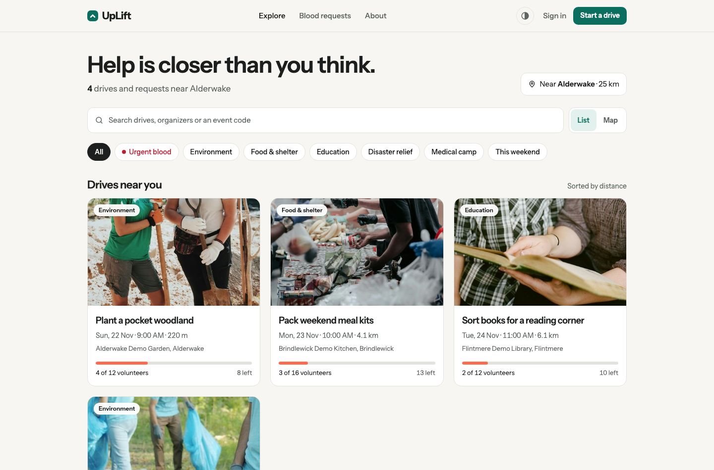
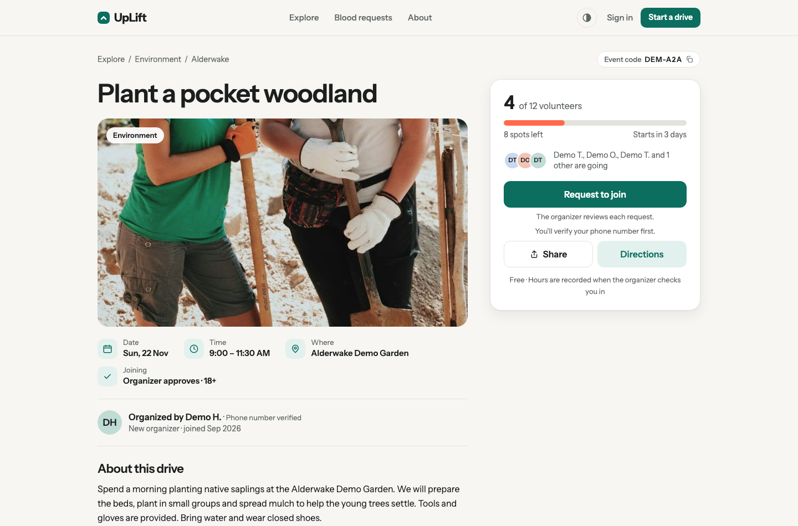
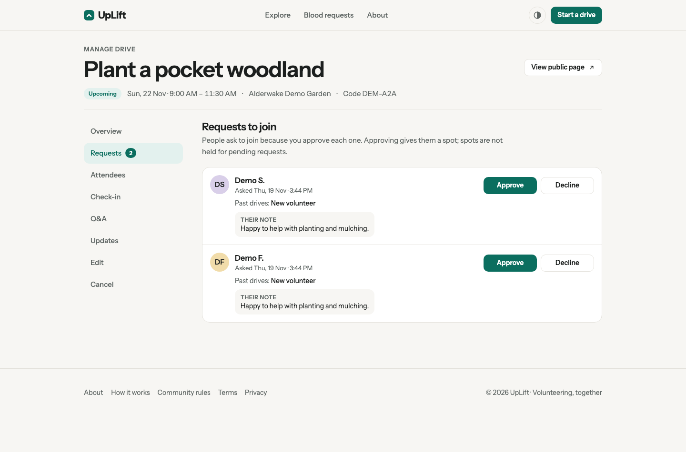
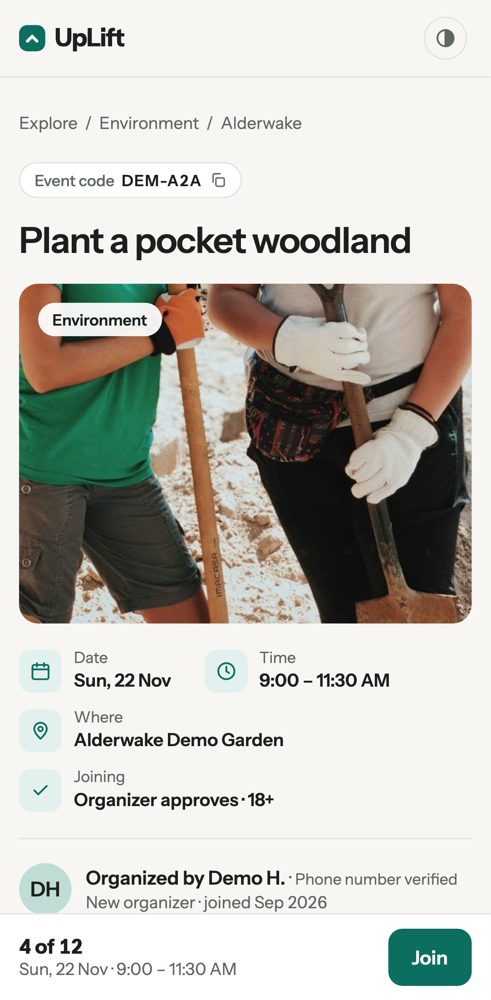

# UpLift

UpLift is a platform for volunteering and urgent blood donation. Organisers post drives and urgent blood requests so volunteers can find them nearby and sign up.

UpLift is in active development and is planned to launch in the coming weeks. The source is private. A demo is available on request.

## Key features

- **Explore feed** — Find nearby drives and urgent requests. Search, filter by category, or switch to the map.
- **Join flow** — Browse as a guest, then sign in with a phone code to join. Organisers can allow instant signup with a waitlist or approve volunteers individually.
- **Organiser dashboard** — Review applications, manage attendees, and post updates.
- **Volunteer profiles** — See verified volunteer hours, participation history, and upcoming drives.
- **Drive Q&A** — Ask the organiser a question. Organisers can add an answered question to the public FAQ.

## Screenshots

Captured from the running app with fictional demo data.

### Explore feed

### Drive page

### Organiser dashboard

### Mobile drive page

## Tech stack

Next.js, TypeScript, Supabase (PostgreSQL), Row Level Security (RLS), Vitest, Playwright, GitHub Actions CI, and Vercel.

## Engineering highlights

- **Database and permissions** — 40 application tables across 36 migrations. Access rules live in the database. RLS is enabled on all API-exposed application tables. App users write through database functions that check permissions. Sensitive blood-request contact details are stored in a private schema.
- **Application** — 19 product pages and 5 API routes.
- **Automated tests** — A full GitHub Actions run passed 929 Vitest tests, 1,760 pgTAP database assertions, and 436 Playwright test runs across desktop and mobile browser configurations. The suite includes accessibility checks and tests for database permissions.
- **Delivery** — GitHub protects the main branch with required pull requests and CI checks. Vercel provides preview deployments for pull requests.

I led product decisions and directed the AI coding workflow, using written architecture contracts, code review, and required CI checks. AI agents generated the application code.

## What I learned and key decisions

- **Design for shared links.** A drive link should take someone straight to the details, with sign-in required when they decide to join.
- **Make privacy a database rule.** A blood request can be public while access to the contact details depends on whether a donor has committed.
- **Make attendee visibility opt-in.** Volunteers choose whether their name appears publicly on a drive.
- **Set clear expectations for urgent requests.** In the first release, requesters share the link themselves. The app does not send donor alerts.
